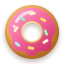
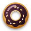
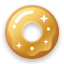
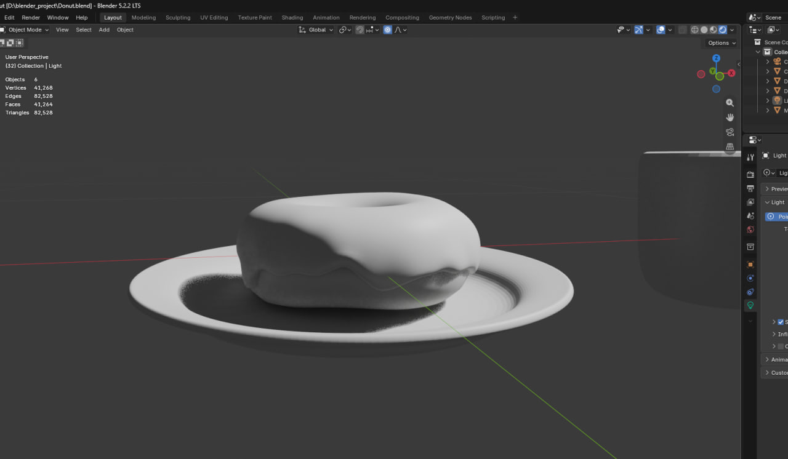

<div align="center">





# Donut 3D — Interactive Bakery Craft Showcase

**Інтерактивний 3D-сайт крафтової пекарні з власними 3D-моделями пончиків із Blender, процедурними GLSL-шейдерами рідкої глазурі та скрол-анімаціями.**

🌐 **Live Demo:** [**donut-3d-five.vercel.app**](https://donut-3d-five.vercel.app/#hero-title)

</div>

---

## 🍩 Моделювання в Blender (Custom 3D Asset)

Усі 3D-моделі пончиків у цьому проєкті (**Wild Strawberry**, **Black Cocoa & Sesame**, **23K Honey-Butter Gold**) створені мною власноруч з нуля у **Blender** (`Donut.blend`) і експортовані у формат `.glb` для WebGL:



- **Скульптинг та геометрія:** органічна форма бріош-тіста та нерівномірні патьоки глазурі зі скульптингом країв (`41,268` вершин / `82,528` трикутників у сцені).
- **Geometry Nodes:** процедурна генерація та розподіл посипки по поверхні глазурі.
- **PBR-текстурування та шейдинг:** 2K-карти нормалей і шорсткості (`Poliigon Food Pastry & Strawberry Glaze`), які у браузері доповнюються процедурними `CanvasTexture`-картами кольору та багатошаровим `MeshPhysicalMaterial` (`clearcoat`, `sheen`, `clearcoatNormalMap`).

---

## ✨ Основні фічі проєкту

1. **Три інтерактивні 3D-секції смаків:**
   - **01 · Wild Strawberry (`#hero-title`)** — пончик із полуничною глазур’ю *Mara des Bois* (можна крутити мишкою або пальцем на 360° за допомогою `PresentationControls`), студійне освітлення з плаваючим відблиском та фонове перетікання рожевої глазурі.
   - **02 · Black Cocoa & Sesame (`#black-section`)** — sticky-секція зі скрол-керованими фіранками темної какао-глазурі, які стікають по краях екрана й утворюють глянцевий шоколадний басейн.
   - **03 · The Gold One (`#order`)** — лімітований пончик із медово-масляною глазур’ю (*Beurre Noisette*) та листям їстівного золота 23К із частинками золотого пилу (`Sparkles`) та урочистою появою.

2. **Процедурний GLSL-шейдер рідкої глазурі (`Glaze.tsx`):**
   - Побудований на основі двовимірного поля знакових відстаней (**2D Signed Distance Field / SDF**) зі згладженим об’єднанням крапель (`smin`).
   - Відтворює об’ємний профіль меніска, екранні нормалі, підповерхневе розсіювання світла, подвійний спекулярний блік, мікро-рельєф цукрової поливи та м’яку контактну тінь на сторінці.

3. **Єдиний WebGL-контекст із `<View>` Scissoring (`Scene.tsx` + `views.tsx`):**
   - Уся сторінка використовує **один спільний `<Canvas>`**, у який через `@react-three/drei` `<View>` врізаються 5 окремих 3D/GLSL-портів.
   - Неактивні секції поза екраном автоматично призупиняють обчислення кадрів через `IntersectionObserver`.

4. **Динамічний SVG Favicon:**
   - Кастомні векторні іконки пончиків (`favicon-pink.svg`, `favicon-black.svg`, `favicon-gold.svg`) та заголовок вкладки браузера автоматично змінюються в реальному часі під час скролу між рожевим, чорним і золотим пончиками.

---

## 🛠 Технологічний стек

| Категорія | Технології |
| :--- | :--- |
| **Фреймворк** | [Next.js 16](https://nextjs.org/) (App Router, Turbopack), [React 19](https://react.dev/), TypeScript 5 |
| **3D та WebGL** | [Three.js](https://threejs.org/) (`r186`), [React Three Fiber](https://r3f.docs.pmnd.rs/), [`@react-three/drei`](https://drei.docs.pmnd.rs/) |
| **Шейдери та Матеріали** | Кастомні GLSL Vertex/Fragment шейдери (2D SDF), `MeshPhysicalMaterial`, процедурні `CanvasTexture` |
| **Анімації** | [GSAP 3](https://gsap.com/) (`ScrollTrigger`, `@gsap/react`, `matchMedia` з підтримкою `prefers-reduced-motion`) |
| **3D-моделювання** | **Blender** (Sculpting, Geometry Nodes, UV Unwrapping, `.glb` експорт) |
| **Стилізація та Шрифти** | [Tailwind CSS v4](https://tailwindcss.com/), Google Fonts (`Modak` + `Bricolage Grotesque`) |
| **Деплой** | [Vercel](https://donut-3d-five.vercel.app/#hero-title) |

---

## 📂 Структура проєкту

```text
donut3d/
├── app/
│   ├── globals.css          # Дизайн-токени кольорів пекарні та типографіка
│   ├── layout.tsx           # Підключення шрифтів Modak / Bricolage та метаданих
│   └── page.tsx             # Головна сторінка
├── components/
│   ├── Landing.tsx          # Розмітка секцій, GSAP ScrollTrigger та зміна favicon при скролі
│   ├── Loader.tsx           # Екран завантаження 3D-сцен із прогресом
│   └── three/
│       ├── DonutModel.tsx   # Завантаження .glb, центрування та генерація PBR-матеріалів глазурі
│       ├── Glaze.tsx        # GLSL SDF-шейдер рідкої глазурі (hero pour & cocoa curtains)
│       ├── Scene.tsx        # Спільний фіксований WebGL Canvas + очищення буфера кадру
│       └── views.tsx        # Сцени для кожного порту, студійне світло, камера та тіні
├── lib/
│   └── sceneState.ts        # Спільний реактивний стан прогресу анімацій між GSAP і R3F
└── public/
    ├── Donut-pink.glb       # 3D-модель полуничного пончика з Blender
    ├── Donut-black.glb      # 3D-модель какао-пончика з Blender
    ├── Donut-gold.glb       # 3D-модель золотого пончика з Blender
    ├── favicon-pink.svg     # Іконка рожевого пончика
    ├── favicon-black.svg    # Іконка шоколадного пончика
    └── favicon-gold.svg     # Іконка золотого пончика
```

---

## 🚀 Локальний запуск

1. **Встановіть залежності:**
   ```bash
   npm install
   ```

2. **Запустіть сервер розробки:**
   ```bash
   npm run dev
   ```

3. **Відкрийте у браузері:**
   Перейдіть за адресою [http://localhost:3000](http://localhost:3000).
